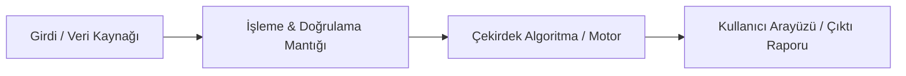

# Altyapı Manager — Spor Kulübü, Taktik & Oyuncu Yönetim Sistemi

> **Rozet / Statü:** Açık Kaynak Sistem | **Kategori:** Web Tabanlı Spor Yönetim Platformu

**Öne Çıkan Metrik / Başarım:** 📋 İnteraktif Taktik Tahtası & Oyuncu Karnesi

* **GitHub Reposu:** [https://github.com/oguztasdemir/Altyapi-Manager](https://github.com/oguztasdemir/Altyapi-Manager)

---

## 1. Projenin Amacı ve Ne İşe Yaradığı
Spor kulüplerinde antrenörlerin taktik çizimlerini simüle ettiği, oyuncu gelişim karnelerini tuttuğu ve yapay zeka asistanıyla kulüp verilerini sorguladığı yönetim aracı.

### Çözülen Problem & İhtiyaç:
Marketimin üst katındaki komşum yeni bir spor altyapı akademisi açıyordu ve federasyon lisansını beklerken 'Bana Football Manager seviyesinde, tüm kulüp yönetimini yapabileceğim bir uygulama yapar mısın?' diyerek bana ilk ticari iş teklifini getirdi. Kağıt-defter karmaşasını bitiren; oyuncu gelişim kartlarını, aidat/devam takibini, sakatlık geçmişini ve antrenör taktik tahtasını tek ekranda toplayan bu sistemi geliştirip başarıyla teslim ettim.

---

## 2. Kullanılan Teknolojiler & Sistem Mimarisi
### Teknoloji Yığını:
* Python
* FastAPI
* HTML5 Canvas
* SQLite
* RAG Asistanı

### Sistem Mimarisi & Çalışma Mantığı:
Uygulama modern web teknolojileri ve hafif yerel veritabanı mimarisiyle inşa edildi. Oyuncu profilleri, yaş grupları (U12-U19), fiziksel gelişim metrikleri (hız, dayanıklılık, teknik puanlar) ve devam durumları modüler sekmelerde yönetilir. Taktik tahtası üzerinde sürükle-bırak formasyon dizilimi ve maç planlama simülasyonu çalışır.

### Karşılaşılan Zorluklar ve Mühendislik Çözümü:
Futbol akademisinin antrenman sahasında internet olmadan da oyuncu yoklamalarını ve taktik planlarını hızlıca girebilmesi için çevrimdışı önbellek ve anlık dışa aktarma (PDF/Excel) modülü geliştirdim.

---

### Sistem Akış Şeması:


---

## 3. Temel Özellikler & Fonksiyonlar
* İlk ticari yazılım projem olarak spor akademisine özel geliştirilip teslim edilen sistem
* Football Manager tarzı oyuncu gelişim kartları ve yetenek puanlaması
* Antrenörler için interaktif sürükle-bırak taktik ve formasyon tahtası
* Aidat, devam-devamsızlık ve sakatlık geçmişi takip paneli

---

## 4. Tasarım, Ekran Görüntüleri ve Medya
<!-- Bu alana ekran görüntüleri (screenshot), mimari diyagramları ve çalışma GIF/videoları eklenecektir -->
* Görseller ve medya içerikleri eklenecektir.

---

## 5. Hızlı Başlangıç & Çalıştırma
Projeyi yerel ortamınızda çalıştırmak için aşağıdaki adımları izleyebilirsiniz:

```bash
# 1. Repoyu klonlayın
git clone https://github.com/oguztasdemir/Altyapi-Manager.git
cd Altyapi-Manager

# 2. Bağımlılıkları yükleyin
pip install -r requirements.txt

# 3. Uygulamayı başlatın
python main.py
```

---

## 6. Test Edilebilirlik & Güvenilirlik
* **Girdi Doğrulama:** Geçersiz parametre ve eksik veri durumları hata yakalama (try-except / error boundaries) mekanizmalarıyla izole edilmiştir.
* **Hafif & Modüler Yapı:** Gereksiz harici kütüphane bağımlılıklarından kaçınılmış, kod blokları modüler fonksiyonlar halinde organize edilmiştir.
* **Farklı Ortam Uyumluluğu:** Windows yerel çalışma ortamında test edilmiş ve stabil çalıştığı doğrulanmıştır.

---

## 7. Kapsamlı Teknik Soru-Cevap (Q&A) Havuzu
Bu projeyle ilgili teknik görüşmelerde, kod incelemelerinde veya proje sunumlarında gelebilecek kritik sorular ve yanıtları:

### S1: Bu projeyi geliştirmeye neden ihtiyaç duydunuz? Çözdüğünüz asıl darboğaz neydi?
* **Cevap:** Mevcut hazır araçların getirdiği kısıtlamaları, yüksek hata payını veya manuel süreçlerin yarattığı zaman kaybını ortadan kaldırmak için geliştirdim. Harici ücretli servislere veya API anahtarlarına bağımlı kalmadan, doğrudan yerel ortamda hızlı ve kararlı sonuç üreten bir yapı kurguladım.

### S2: Neden bu mimariyi ve teknoloji yığınını tercih ettiniz?
* **Cevap:** İşlem hızı, düşük bellek tüketimi ve işletim sistemi seviyesindeki donanım/dosya erişim kabiliyetleri nedeniyle bu teknoloji yığınını seçtim. Üçüncü parti ağır bağımlılıklar yerine çekirdek kütüphanelerle modüler bir yapı kurdum.

### S3: Kod mimarisinde modülerliği ve sürdürülebilirliği nasıl sağladınız?
* **Cevap:** Fonksiyonları ve modülleri tek sorumluluk prensibine (Single Responsibility) göre ayırdım. Veri işleme mantığı ile kullanıcı arayüzü / girdi-çıktı katmanını birbirinden izole ederek kodun okunabilirliğini, bakımını ve test edilebilirliğini kolaylaştırdım.

### S4: Geliştirme sürecinde karşılaştığınız en büyük teknik zorluk neydi ve nasıl çözdünüz?
* **Cevap:** Beklenmedik girdi formatları, donanım/bağlantı kesintileri ve uç senaryolarda (edge cases) sistemin kararlılığını korumak en kritik konuydu. Kapsamlı hata yakalama blokları, veri doğrulama filtreleri ve kontrollü geri dönüş (fallback) mekanizmaları kurarak sistemin çökmeden çalışmasını sağladım.

### S5: Veri miktarı veya iş yükü 100 katına çıksaydı sistemde ne gibi darboğazlar oluşurdu ve nasıl ölçeklerdiniz?
* **Cevap:** Mevcut yerel bellek (RAM) ve tekil iş parçacığı sınırları darboğaz yaratabilirdi. Bu durumda veriyi belleğe tek seferde yüklemek yerine parça parça işleme (chunking / streaming), asenkron görev kuyrukları ve çoklu işlemci (multiprocessing) mimarisine geçerek sistemi ölçekleyebilirdim.

### S6: Projede veri bütünlüğü ve kaynak yönetimi adına hangi önlemleri aldınız?
* **Cevap:** Kullanıcıdan veya dış kaynaklardan gelen tüm girdileri tip ve sınır kontrolünden geçirdim. Dosya, veritabanı ve soket işlemlerinde bellek sızıntısını (memory leak) önlemek için güvenli kapatma protokolleri uyguladım.

### S7: Bu projeye bugün sıfırdan başlasaydınız neyi farklı yapardınız?
* **Cevap:** Geliştirme sürecinin en başından itibaren kapsamlı birim testlerini (unit tests) ve otomatik doğrulama adımlarını yazar, modüller arası veri yapılarını katı şema doğrulayıcılarla (type annotations / schema validation) standartlaştırırdım.

---

## 8. Güvenlik, Veri Bütünlüğü & Hata Yönetimi
* **Girdi Denetimi (Input Sanitization):** Kullanıcıdan veya harici kaynaklardan gelen verilerin tipleri ve sınır değerleri doğrulanır.
* **Hata İzolasyonu (Graceful Degradation):** Beklenmedik bir veri bozulması veya bağlantı kesintisi durumunda sistemin çökmesi engellenir; kontrollü hata mesajı üretilir.
* **Kaynak Yönetimi:** Bellek sızıntılarını önlemek için dosya tanıtıcıları ve bağlantılar işlem tamamlandığında güvenle kapatılır.

---

## 9. Gelecek Yol Haritası (V2.0 Roadmap)
* [ ] **Kapsayıcı Desteği (Dockerization):** Uygulamanın ve bağımlılıklarının izole bir konteyner yapısına alınması.
* [ ] **Gelişmiş Metrik & Loglama:** Olası hataların ve performans darboğazlarının izlenebilmesi için yapılandırılmış loglama altyapısı.
* [ ] **Otomatik Test Süreçleri:** Temel fonksiyonlar için birim ve entegrasyon testlerinin genişletilmesi.
